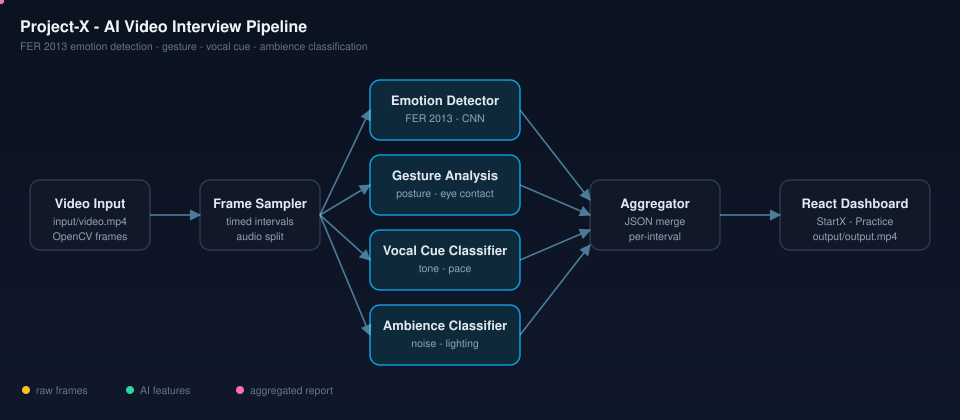

# Project-X
AI based video interviews

## Architecture

**Pipeline:** Video input (OpenCV frame sampling) -> parallel AI models (FER 2013 emotion detection, gesture analysis, vocal cue classification, ambience classification) -> JSON aggregation -> React dashboard with annotated output video.

- **Backend:** Python, SQLite, service-oriented routes (users, cases)
- **Frontend:** React (Create React App), StartX institution dashboard + Interview Practice candidate flow
- **AI/ML:** FER 2013 emotion detection, gesture analysis, vocal cue classification, ambience/environment classification
- **Dataset:** [FER 2013](https://www.kaggle.com/datasets/msambare/fer2013) + custom gesture/vocal/ambience datasets

See [llms.txt](./llms.txt) for an AI-readable project summary and cross-links to related AI/ML work.
